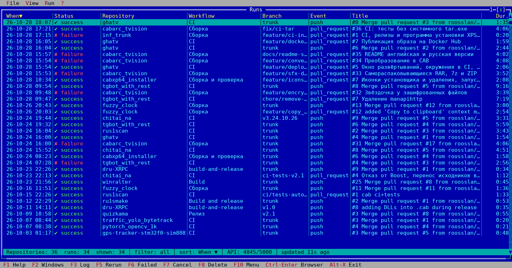

# ghatv

**English** | [Русский](README.ru.md)

A turbo-vision dashboard of GitHub Actions across all repositories of an account, in the style of a file manager. The Turbo Vision interface opens in a browser via [ttyd](https://github.com/tsl0922/ttyd). Everything runs in a single Docker container.

```
browser ──ws──> ttyd ──pty──> ghatv (C++/tvision) ──HTTPS──> api.github.com
```



## Features

- Four main windows: workflow runs, open pull requests, open issues and deployments (GitHub Deployments) across all repositories.
- Run list: start time (date and time), status, repository, workflow, branch, event, title, duration.
- Sorting by any column with a mouse click on its header; a second click reverses the order.
- Filters: all, active (in progress, queued, waiting), failed, successful, other. Text search and a "latest run only" mode for each workflow and branch pair.
- Run window: jobs, steps and annotations (short error messages). While the run is not finished, the window refreshes itself.
- Job log viewer: highlighting of groups, errors and warnings, jumping to the error, search.
- Actions: rerun, rerun failed jobs only, cancel, delete a run, delete logs only. Actions apply to the current row or to all marked rows.
- Open pull requests window. The CI status is taken from the already loaded runs for the latest PR commit, without extra requests. Enter or a double click opens the PR card: branches, number of commits and files, merge state and all CI runs for the latest commit; the description and comments open from the card.
- Open issues window: issues in your own repositories and issues created by the user in other repositories (via GitHub search). Enter opens the description and comments.
- Deployments window: environment, ref, latest status, creator and description. Enter opens the status history.
- English (default) and Russian interface; the language is switched on the fly with Ctrl+L.
- Opening a run, PR, issue, job or discussion on github.com in a new browser tab (`o` key).
- Polling with ETag. 304 responses do not consume the API rate limit. Repositories with active runs are polled more often.

## Token

A GitHub token with access to Actions is required:

- a classic PAT or the `gh` token with the `repo` scope (`public_repo` is enough for public repositories);
- a fine-grained PAT with **Actions: Read and write**, **Metadata: Read**, **Pull requests: Read**, **Issues: Read** and **Deployments: Read** permissions. Actions: Read is enough for viewing only.

Issues created in other repositories are found via GitHub search and are visible only within the token's permissions.

If GitHub CLI is installed, its token can be used: `gh auth token`.

## Running

With docker compose (the port is reachable from this computer only):

```bash
GH_TOKEN=$(gh auth token) docker compose up -d --build
```

Then open http://localhost:7681. For the Russian interface, use http://localhost:7681/?arg=--lang=ru (or the `GHATV_LANG=ru` variable).

A prebuilt image from GitHub Container Registry (built by CI from the `trunk` branch and release tags):

```bash
docker run -d --name ghatv -p 127.0.0.1:7681:7681 -e GH_TOKEN=$(gh auth token) -e TZ=Europe/Moscow ghcr.io/roosslan/ghatv:latest
```

Building the image manually, without compose:

```bash
docker build -t ghatv .
```

```bash
docker run -d --name ghatv -p 127.0.0.1:7681:7681 -e GH_TOKEN=$(gh auth token) -e TZ=Europe/Moscow ghatv
```

The token can be put into a `.env` file next to `docker-compose.yml` (a `GH_TOKEN=...` line). The file is excluded from git.

Each browser tab starts a separate ghatv instance with its own API polling.

## Configuration

| Variable | Default | Purpose |
|---|---|---|
| `GH_TOKEN` | — | GitHub token (`GITHUB_TOKEN` is also read) |
| `GHATV_AFFILIATION` | `owner` | which repositories to take: `owner`, `collaborator`, `organization_member` or a comma-separated list of them |
| `GHATV_OWNERS` | — | keep only these owners (comma-separated) |
| `GHATV_REPOS` | — | explicit list of repositories `owner/name` or `name`; disables the other filters |
| `GHATV_EXCLUDE` | — | exclude repositories |
| `GHATV_INCLUDE_FORKS` | `false` | show forks |
| `GHATV_INCLUDE_ARCHIVED` | `false` | show archived repositories |
| `GHATV_RUNS_PER_REPO` | `20` | how many latest runs to take from each repository (up to 100) |
| `GHATV_INTERVAL` | `60` | polling interval for a repository without active runs, seconds |
| `GHATV_ACTIVE_INTERVAL` | `10` | polling interval for a repository with active runs, seconds |
| `GHATV_PULLS` | `true` | poll open pull requests (every `GHATV_INTERVAL`) |
| `GHATV_ISSUES` | `true` | poll open issues (every `GHATV_INTERVAL`) |
| `GHATV_DEPLOYMENTS` | `true` | poll deployments (every `GHATV_INTERVAL`, up to the 10 latest in each repository) |
| `GHATV_THREADS` | `6` | number of parallel requests while polling |
| `GHATV_LANG` | `en` | interface language: `en` or `ru`; the `--lang` argument (including from the `?arg=--lang=ru` address) takes precedence |
| `GITHUB_API_URL` | `https://api.github.com` | API address |
| `TZ` | — | time zone for displayed times |

The repository list is reread every 10 minutes or on Ctrl+R.

## Keys

| Key | Action |
|---|---|
| Enter, double click | open the row: run, PR card, issue; in the run window — the job or step log |
| Esc, Backspace | back: close the current window (in dialogs Backspace deletes text) |
| o, Ctrl+Enter | open the current object on github.com in a new browser tab |
| Ctrl+L | interface language: English / Русский |
| F3 | log of the failed job |
| F5, r | rerun |
| F6, f | rerun failed jobs |
| F7, c | cancel |
| F8, Del | delete the run |
| Shift+F8 | delete logs only |
| Ins | mark the row; `+` mark all visible, `-` unmark all |
| 1…5 | filter: all / active / failed / successful / other |
| /, Ctrl+F | search |
| l | latest run of each workflow and branch only |
| click on a column header | sort by the column; a second click reverses the order |
| s | sort by the next column |
| F2 | next main window: runs → PRs → issues → deployments |
| Alt+1 … Alt+4 | runs / pull requests / issues / deployments |
| Ctrl+R | refresh everything |
| F10, F9 | menu |
| Alt+X | exit |

In the pull requests window: Enter — PR card, F3 — log of the failed PR run, F5/F6/F7 — rerun / rerun failed / cancel the PR runs, `1…5` — filter by CI status, `d` — hide drafts, `/` — search, `s` — sort. Runs are not deleted from this window.

In the PR card: Enter — run, `d` or a click on the "Description and comments" line — discussion, F3 — log, F5/F6/F7 — actions on the run.

In the issues window: Enter — description and comments, `1` — all, `2` — in your own repositories, `3` — created by the user in other repositories.

In the deployments window: Enter — status history, `o` — deployment log (usually an Actions run) or the environment address in the browser, `1…5` — filter by the latest status.

The CI status in the PR list is taken from the latest `GHATV_RUNS_PER_REPO` runs of the repository: a PR that has not been updated for a long time may show "no CI".

In the log window: `/` search, `n`/`N` next/previous match, `e`/`E` next/previous error, `g`/`G` top/bottom.
